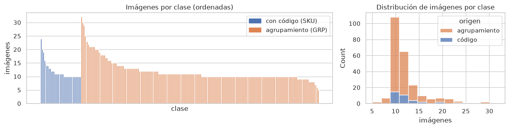
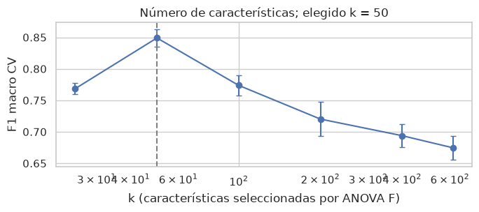
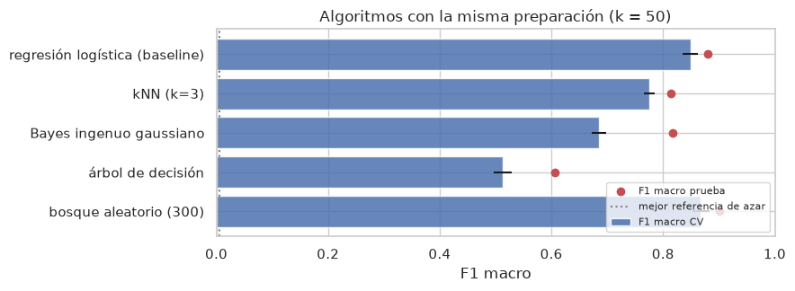
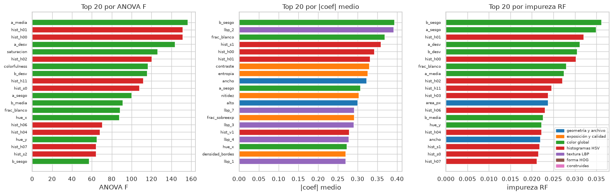
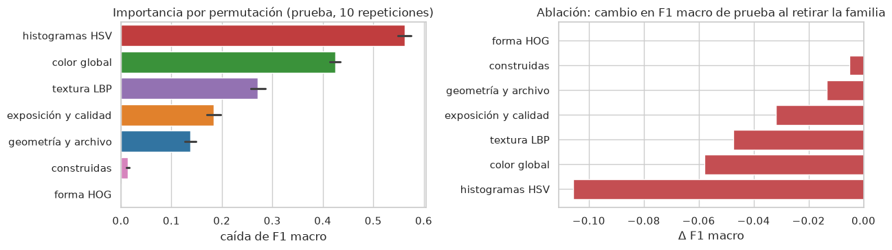
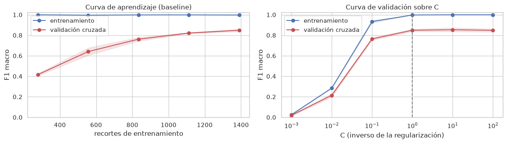
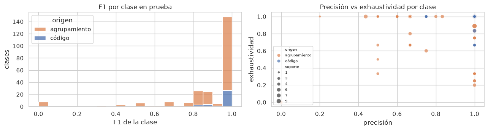
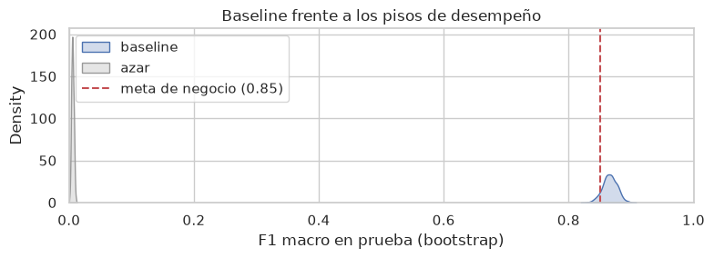

<div style="text-align: center;">

# Avance 3 | Baseline

### Modelo de referencia para el reconocimiento de producto en recortes de anaquel

**Tecnológico de Monterrey** · Maestría en Inteligencia Artificial Aplicada<br>
**TC5035.10 — Proyecto Integrador (Grupo 10)**

**Equipo 48** · **Modalidad:** En equipo · **Fecha:** 18 de octubre de 2026

| Integrante | Matrícula |
|---|---|
| Oscar Alberto Ramírez Anaya | A01795438 |
| Germán Eduardo Rodríguez Vázquez | A01796325 |
| Jesús Soto Medrano | A01794746 |

**Profesora:** Dra. Grettel Barceló Alonso · **Asesor:** Dr. Raúl Valente Ramírez<br>
**Sponsor:** Dr. Juan Arturo Nolazco Flores · **Organización:** Bnext

</div>

---

**Entregable:** [`Avance3.48.ipynb`](./Avance3.48.ipynb) ·
[Ver en nbviewer](https://nbviewer.org/github/oscar-ramirez-anaya/Avance3_Equipo48/blob/main/Avance3.48.ipynb) ·
[Reporte PDF](./Avance3.48.pdf) · [Reporte DOCX](./Avance3.48.docx)

## Resumen

Fase de **Ingeniería del modelo** de CRISP-ML(Q). Se construye un modelo de referencia para reconocer el
producto en recortes de anaquel, sobre todos los recortes etiquetados disponibles en el servidor de Bnext:
**2 887 recortes de 241 clases** (35 carpetas con código de producto y 206 carpetas de agrupamiento). El
baseline es una **regresión logística multinomial** sobre 50 características seleccionadas con ANOVA. Se
contrasta con el azar y con otros cuatro algoritmos.

| Indicador | Resultado |
|---|---|
| Mejor clasificador de azar, F1 macro en prueba | **0.006** |
| Baseline, F1 macro en validación cruzada / prueba | **0.849 ± 0.014 / 0.881** |
| Baseline, exactitud top-3 en prueba | **0.951** |
| Intervalo de confianza del 95 % (bootstrap), F1 macro en prueba | **0.842 – 0.887** |
| Meta de negocio (Avance 0), F1 macro ≥ 0.85 | Se cumple por el valor puntual; el intervalo queda en el límite |
| Brecha entrenamiento – validación (F1 macro) | **0.996 – 0.849**: sobreajuste moderado |
| Familia de características más importante | **Color**: histogramas HSV y Lab |

## Cobertura de la rúbrica

| Criterio | Dónde | Evidencia |
|---|---|---|
| **Algoritmo** (40) | Secciones 1, 4 y 5 | La elección se justifica por el tipo de datos (tabulares, estandarizados), la cantidad de datos (5 a 32 imágenes por clase), las características relevantes, la interpretabilidad y la calibración. Se compara con el azar y con cuatro algoritmos bajo la misma validación. |
| **Características importantes** (20) | Sección 6 | Filtro (ANOVA F, curva de k), métodos embebidos (coeficientes y bosque aleatorio), permutación por familia y ablación, con gráficas e interpretación. |
| **Sub / sobreajuste** (10) | Sección 7 | Métricas de entrenamiento, validación cruzada y prueba lado a lado; curva de aprendizaje y curva de validación sobre C. |
| **Métrica** (20) | Sección 8 | F1 macro justificado por el costo de error por producto y el desbalance, con top-3, exhaustividad por clase y desglose por tipo de carpeta. |
| **Desempeño** (10) | Sección 9 | Se declara que no hay histórico de Bnext. El baseline se compara con un piso estadístico (azar, con IC bootstrap) y con un piso de negocio (meta del Avance 0). |

---

## 1. Problema y datos

La tarea es la **clasificación multiclase de recortes de producto**, que es el componente que decide si
una posición del planograma es correcta o está mal ubicada. Hay dos razones para no usar todavía un
detector: las escenas del servidor no tienen anotaciones, y el servidor no tiene GPU. Las carpetas de
agrupamiento no tienen una tabla de correspondencia con productos, así que se asume que cada una es un
producto. Ese supuesto se revisa con los resultados.



## 2. Algoritmo baseline

La selección por ANOVA alcanza su máximo en **k = 50**, el mismo valor del Avance 2. Todos los algoritmos
superan ampliamente al azar. El bosque aleatorio queda ligeramente arriba, pero la diferencia en
validación cruzada es de una desviación estándar. La regresión logística se mantiene como baseline por sus
probabilidades mejor calibradas (log-loss de 0.63 contra 0.99) y su interpretabilidad.

| Modelo | F1 CV | F1 prueba | Top-3 prueba |
|---|---|---|---|
| **Regresión logística (baseline)** | **0.849 ± 0.014** | **0.881** | **0.951** |
| Bosque aleatorio (300 árboles) | 0.867 ± 0.015 | 0.901 | 0.966 |
| kNN (k = 3) | 0.775 ± 0.010 | 0.814 | 0.922 |
| Bayes ingenuo gaussiano | 0.685 ± 0.013 | 0.817 | 0.874 |
| Árbol de decisión | 0.513 ± 0.016 | 0.606 | 0.628 |




## 3. Importancia de las características

El color domina. Permutar los histogramas HSV reduce el F1 macro en 0.56, y permutar el color global, en
0.42. La forma HOG no entra en la selección. La geometría del archivo aporta, pero puede reemplazarse con
otras variables; como las dos campañas de captura difieren en dispositivo, se vigila como posible
artefacto de captura.




## 4. Sub y sobreajuste

El F1 macro pasa de 0.996 en entrenamiento a 0.849 en validación cruzada y 0.881 en prueba: es un
sobreajuste moderado, sin subajuste. La curva de aprendizaje sigue subiendo, así que más imágenes por
clase mejorarían el modelo. La regularización por defecto (C = 1) está en la zona estable.



## 5. Métrica

La métrica principal es el **F1 macro**, porque cada producto pesa igual en el anaquel y hay desbalance
de 6.4 veces. Las clases con código alcanzan 0.964. Los errores se concentran en las carpetas de
agrupamiento, donde los pares más confundidos tienen números consecutivos. Esto sugiere agrupamientos
que podrían ser el mismo producto y que deben validarse con Bnext.



## 6. Desempeño mínimo

No existe un histórico de Bnext, así que se usan dos referencias. El baseline supera el piso estadístico
(azar, 0.006) por más de dos órdenes de magnitud. También alcanza la meta de negocio de 0.85 del Avance
0 por su valor puntual (0.881), aunque el extremo inferior del intervalo (0.842) queda en el límite.
**El desempeño mínimo para los modelos siguientes es F1 macro 0.881 y top-3 0.951 en esta partición.**



## 7. Conclusiones (CRISP-ML(Q))

El problema es viable con métodos simples, y el baseline queda fijado como referencia. Siguientes pasos:

1. Validar con Bnext la correspondencia de las carpetas de agrupamiento con productos.
2. Solicitar capturas de más de una sesión por producto, para medir generalización.
3. Anotar un subconjunto de escenas, para evaluar la detección.
4. Comparar en el Avance 4 el bosque aleatorio y modelos con representaciones aprendidas, con
   optimización de hiperparámetros.

---

## Contenido del repositorio

| Archivo | Descripción |
|---|---|
| **`Avance3.48.ipynb`** | Libreta ejecutada de principio a fin, en secuencia, con salidas y gráficos |
| `Avance3.48.pdf` / `Avance3.48.docx` | Reporte del avance |
| `Avance3.48.html` | Fuente del PDF |
| `figuras/` | Gráficas exportadas de la libreta |
| `scripts/construir_avance3.py` | Genera la libreta (interpretaciones en `avance3_textos.json`) |
| `scripts/generar_documento_avance3.py` | Genera HTML, PDF y DOCX con las figuras de la libreta ejecutada |
| `scripts/verificar_publicacion.py`, `.githooks/` | Verificación previa a cada commit |
| `POLITICA_DATOS.md` | Acuerdo de manejo de datos con Bnext |

## Manejo de datos

La libreta se ejecutó dentro del servidor de Bnext conforme a [`POLITICA_DATOS.md`](POLITICA_DATOS.md).
Las imágenes, las tablas de características y el modelo ajustado permanecen en esa infraestructura. Este
repositorio contiene solo código, gráficas y tablas agregadas, y las clases están anonimizadas.

## Reproducir

```bash
python3 scripts/construir_avance3.py
# en el servidor de Bnext:
export PLANOGRAMA_DATA_DIR=<datos> PLANOGRAMA_OUT_DIR=<salidas> PLANOGRAMA_N_JOBS=6
jupyter nbconvert --to notebook --execute --inplace Avance3.48.ipynb
# de vuelta en el repositorio:
python3 scripts/generar_documento_avance3.py
```

## Referencias

- Géron, A. (2022). *Hands-on machine learning with Scikit-Learn, Keras, and TensorFlow* (3a ed.). O'Reilly Media.
- Visengeriyeva, L., Kammer, A., Bär, I., Kniesz, A., y Plöd, M. (2023). *CRISP-ML(Q). The ML lifecycle process*. MLOps. INNOQ. https://ml-ops.org/content/crisp-ml
- Sokolova, M., y Lapalme, G. (2009). A systematic analysis of performance measures for classification tasks. *Information Processing & Management, 45*(4), 427–437.
- Efron, B., y Tibshirani, R. J. (1993). *An introduction to the bootstrap*. Chapman & Hall.
- Pedregosa, F., et al. (2011). Scikit-learn: Machine learning in Python. *Journal of Machine Learning Research, 12*, 2825–2830.

La bibliografía completa está en el reporte PDF.
